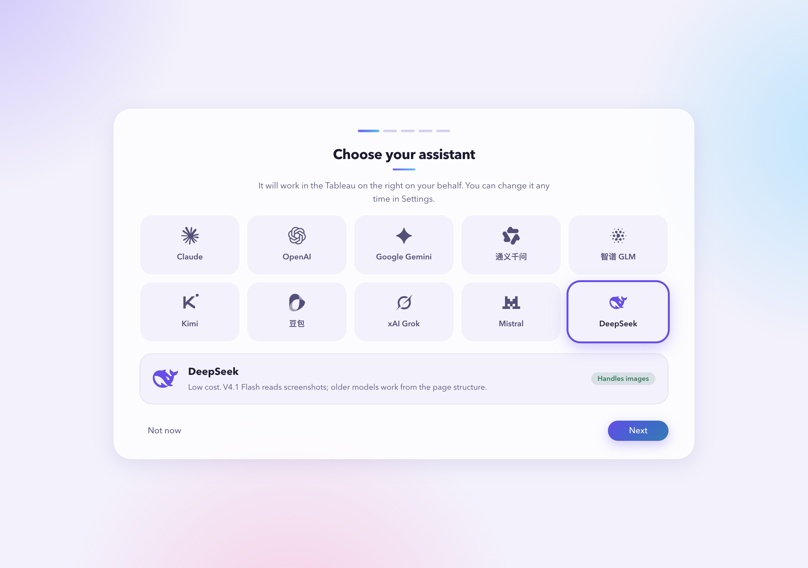
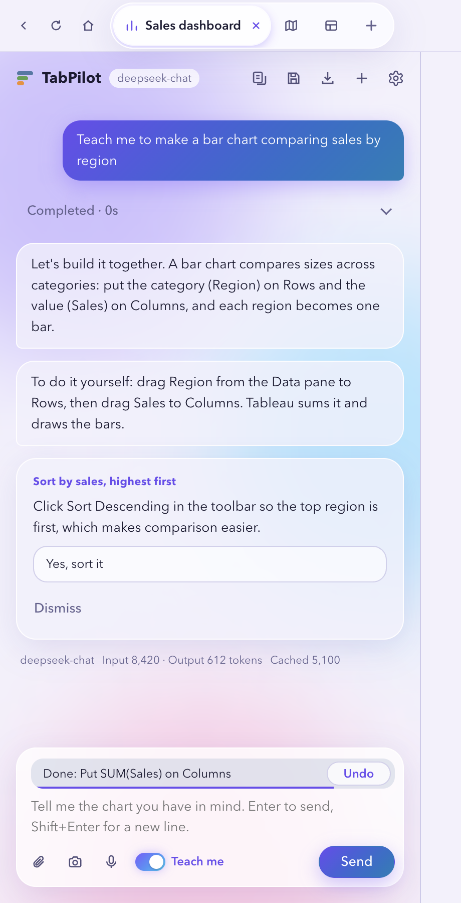
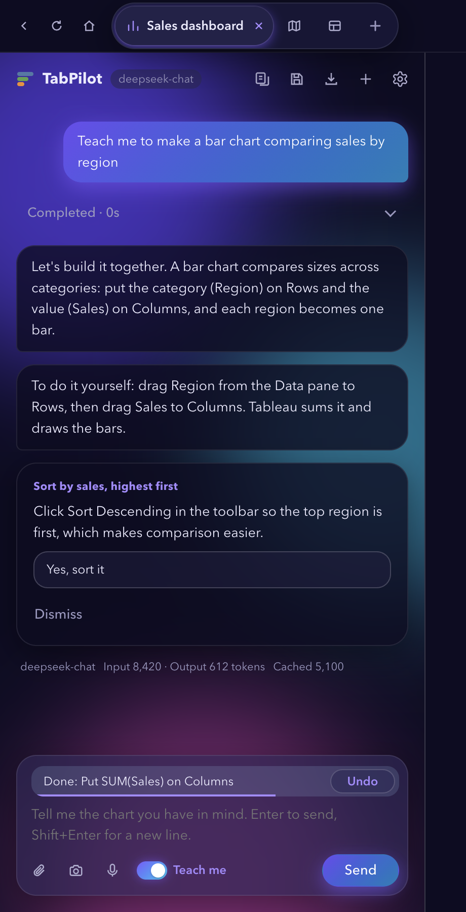

<div align="center">


# TabPilot

**Describe the chart you want and it gets built in Tableau. Want to learn? It walks you through every step.**

[](https://github.com/3520566741-YCLi/TabPilot/releases/latest)
[](LICENSE)


[简体中文](README.md) · English

</div>



## What it is

TabPilot is a desktop app that helps students get started with Tableau quickly. It is built for students whose courses require Tableau but who find the learning curve steep.

The left side of the window is a chat; the right side is the unmodified Tableau Public web app. Tell TabPilot what you want on the left and it builds it on the right with real mouse and keyboard input. Two ways to use it:

- **Teach me**: turn on Teach-me mode and it walks you through doing it yourself, one step at a time: it highlights where to click, explains why, and checks your work. Say "slower", "do this step for me" or "do the rest" any time.
- **Hands-free**: just describe what you need and it builds the whole chart. Good for assignments, recreating examples, or a quick first look.

## Why we built it

Many courses require Tableau for assignments, but first-time users often don't know where to start: which shelf a field goes on, what dimensions and measures are, how many steps a heatmap takes. Tutorial videos mean constant pausing, and classmates aren't always free to help.

TabPilot lowers that barrier by demonstrating each step live in your own Tableau and explaining why. Once you are comfortable, let it build the chart for you and spend your time on the analysis itself.

## Why TabPilot

- **Bring your own model provider and pay only for what you use**: Claude, OpenAI, Gemini, Qwen, Zhipu GLM, Kimi, Doubao, Grok, Mistral and DeepSeek. Use your own key and pay the provider directly. TabPilot charges nothing and has no relay server in between.
- **It is real Tableau**: the right pane is the official Tableau Public web app. TabPilot does not modify Tableau itself, so everything works exactly as before and you can take over by hand at any time.
- **One-click shortcuts**: once signed in, create a new project in one click; uploading local data, switching sheets and exporting are handled for you.

## Features

| | |
|---|---|
| 🖱️ Real input | Drags fields with a real mouse, types expressions on shelves, changes mark types, adds color / size / label |
| 📂 Data & export | Creates Web Authoring workbooks, uploads local Excel / CSV, exports PNG / PDF / Excel / PowerPoint |
| 🔁 Recreate workbooks | Reads .twb / .twbx, lists how each chart is built, then recreates them one by one |
| 🗂️ Project home | Several projects side by side, each with its own Tableau page; favorite, archive, duplicate and rename from the home page |
| 💾 Save & project folders | Save to your own Tableau Public in one click (hidden from your profile) and pick up where you left off; each project gets a local folder with data copies, chart steps and exports |
| 🎙️ Input | On-device voice input, screenshots and images, data file analysis |
| ↩️ In control | Every step is shown in the chat and can be undone; steer or stop while it runs; it always asks before publishing publicly |
| 🌗 Interface | Chinese / English UI, light / dark theme |


<p align="center">
  
  
</p>

## Download

Get the latest version from [Releases](https://github.com/3520566741-YCLi/TabPilot/releases/latest). Pick by this table:

| Computer | File |
|---|---|
| Mac with Apple silicon (M1 / M2 / M3 / M4 …) | `TabPilot-<version>-mac-apple-silicon.dmg` |
| Mac with Intel | `TabPilot-<version>-mac-intel.dmg` |
| Windows on Intel / AMD (most PCs) | `TabPilot-<version>-windows-x64.exe` |
| Windows on Snapdragon (Arm) | `TabPilot-<version>-windows-arm64.exe` |

Not sure? On a Mac, Apple menu → About This Mac → "Chip". On Windows, Settings → System → About → "Processor".

## Install

- **Mac**: open the .dmg and drag TabPilot into Applications. The app is not notarized by Apple, so the first launch may say the developer cannot be verified: right-click TabPilot in Applications → Open, or click "Open Anyway" in System Settings → Privacy & Security. See the [Mac install guide](docs/INSTALL.en.md).
- **Windows**: run the .exe. The installer has no commercial code-signing certificate, so when "Windows protected your PC" appears, click "More info" → "Run anyway". See the [Windows install guide](docs/INSTALL.win.en.md).

On first launch: pick a model provider and paste your own key (TabPilot tests it and recommends a model), sign in to Tableau Public on the right, then type what you want on the left, for example "Create a new Web Authoring workbook and upload sales.xlsx from my Desktop".

## Privacy & security

- **No server of our own**: TabPilot collects no usage data and has no analytics or telemetry. Network traffic goes only to Tableau Public and the model provider you choose.
- **What goes to your provider**: to understand and operate the page, TabPilot sends your request, screenshots and text of the Tableau page, and summaries of data files you point it to. Check your provider's privacy policy before sending sensitive data.
- **Keys stay on your computer**: encrypted with the macOS Keychain or your Windows account, never uploaded.
- **Local files**: only files you point to or drop in are read; project folders live where you choose (Documents/TabPilot by default).
- **Your Tableau account**: you sign in yourself on the right; TabPilot never fills in your password.
- **Public content needs your OK**: anything published to Tableau Public is public, so TabPilot asks every time. The Save button is the one exception: the first time you use it, TabPilot explains that saving publishes to your own Tableau Public, hidden from your profile but visible to anyone with the link. Once you agree, later saves overwrite the same workbook without asking again.
- **Voice stays local**: speech is recognized by the operating system on your device; recordings are not uploaded.
- **Optional third-party services**: OpenAI speech-to-text and TypeSafe step verification are used only if you add those keys in Settings.

To report a vulnerability, see [SECURITY.md](SECURITY.md).

## Run from source

Requires Node.js 20 or later. Building the voice helper on macOS requires the Xcode command line tools.

```bash
npm install
npm run build:native   # macOS only: build the on-device speech helper
npm start              # run in development
npm run dist           # package for macOS (arm64 + x64)
npm run dist:win       # package for Windows (x64 + arm64)
```

Architecture and debugging notes (in Chinese): [docs/DEVELOPMENT.md](docs/DEVELOPMENT.md).

## Contributing

Issues and pull requests are welcome; please read [CONTRIBUTING.md](CONTRIBUTING.md). Versions follow [Semantic Versioning](https://semver.org/); see [CHANGELOG.md](CHANGELOG.md).

## License

[MIT](LICENSE). Use, modify and redistribute freely; just keep the copyright notice. Third-party resources are listed in [THIRD_PARTY_NOTICES.md](THIRD_PARTY_NOTICES.md).

TabPilot is an independent open-source project and is not affiliated with or endorsed by Tableau or Salesforce. Tableau is a trademark of Salesforce, Inc. Model provider names and logos belong to their respective owners.
