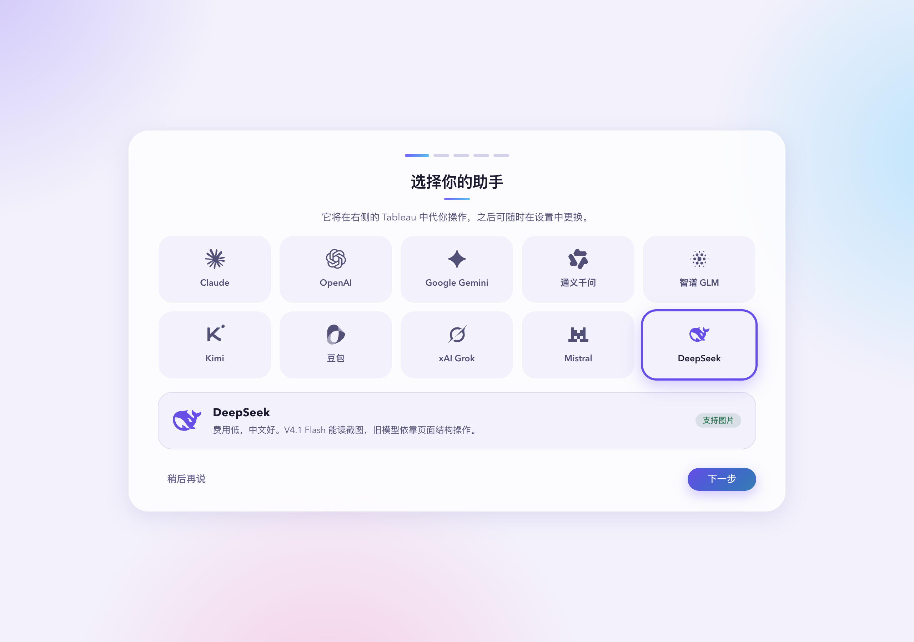
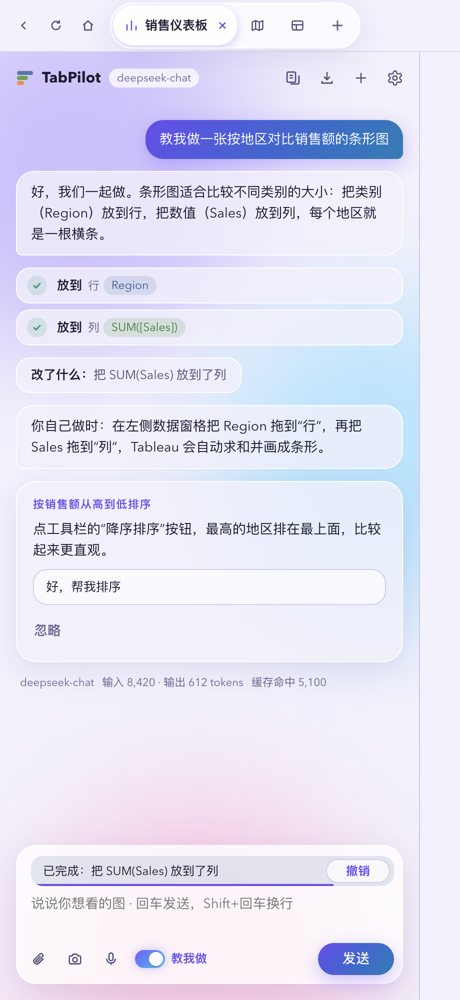

<div align="center">


# TabPilot

**用中文说一句，Tableau 里的图就做好了；想学的话，它一步一步教你做。**

[](https://github.com/3520566741-YCLi/TabPilot/releases/latest)
[](LICENSE)


简体中文 · [English](README.en.md)

</div>



## 这是什么

TabPilot 是一个帮学生快速上手 Tableau 的桌面软件，主要面向课程要求学 Tableau、但觉得入门有门槛的同学。

窗口左边是对话框，右边是原汁原味的 Tableau Public 网页版。你在左边说想做什么图，TabPilot 就在右边用真实的鼠标和键盘把它做出来。两种用法：

- **教我做**：打开“教我做”模式，它一步一步带你自己动手：高亮要点的位置、讲清为什么这样做，你做完它再检查。可以说“慢一点”“这步帮我做”或“剩下的直接做”。
- **全自动**：直接说需求，它把整张图做完，适合赶作业、复刻范例或者先看看效果。

## 为什么做这个

很多学校的课程要求用 Tableau 做作业，但第一次打开它的同学往往不知道从哪下手：字段该拖到哪、度量和维度有什么区别、一张热力图要几步。看教程视频要来回暂停对照，问同学也不一定有空。

TabPilot 想把这道门槛降下来：在你自己的 Tableau 里，当场演示每一步，讲清楚为什么这样做。等你熟悉了，也可以让它直接把图做完，把时间留给分析本身。

## 为什么用 TabPilot

- **模型服务商随你选，费用自己掌握**：支持 Claude、OpenAI、Gemini、通义千问、智谱 GLM、Kimi、豆包、Grok、Mistral、DeepSeek。填你自己的密钥，按实际用量付给服务商，TabPilot 不收任何费用，也不经过任何中转服务器。
- **用的就是原生 Tableau**：右边嵌入的是 Tableau Public 官方网页版，TabPilot 不修改 Tableau 本身。Tableau 原来怎么用，现在还怎么用，你随时可以自己接手操作。
- **常用操作一键完成**：登录后一键新建项目，自动上传本地数据、切换工作表、导出文件，省掉来回点菜单的时间。

## 功能

| | |
|---|---|
| 🖱️ 真实操作 | 真实鼠标拖拽字段、在功能区键入表达式、切换标记类型、加颜色 / 大小 / 标签 |
| 📂 数据与导出 | 新建 Web 制作工作簿、上传本地 Excel / CSV、导出 PNG / PDF / Excel / PPT |
| 🔁 复刻工作簿 | 读取 .twb / .twbx，列出每张图的做法，再逐张复刻 |
| 🗂️ 项目主页 | 多个项目并排打开，每个项目一个独立的 Tableau 页面；主页里收藏、归档、复制、改名 |
| 💾 保存与项目文件夹 | 一键保存到你自己的 Tableau Public（不在个人主页显示），下次打开接着编辑；每个项目一个本地文件夹，放数据副本、建图步骤和导出文件 |
| 🎙️ 多种输入 | 本机语音输入、截图和图片、数据文件分析 |
| ↩️ 可控 | 每一步都显示在对话里，可以撤销；运行中可以插话或停止；公开发布前一定先问你 |
| 🌗 界面 | 中文 / English 全局切换（首次打开先选语言，设置里随时改），浅色 / 深色主题 |


<p align="center">
  
  
</p>

## 下载

到 [Releases](https://github.com/3520566741-YCLi/TabPilot/releases/latest) 下载最新版本：

| 电脑 | 下载这个 |
|---|---|
| Mac（M1 / M2 / M3 / M4 等 Apple 芯片） | `TabPilot-<版本>-mac-apple-silicon.dmg` |
| Mac（英特尔芯片） | `TabPilot-<版本>-mac-intel.dmg` |
| Windows（英特尔 / AMD，绝大多数电脑） | `TabPilot-<版本>-windows-x64.exe` |
| Windows（骁龙笔记本） | `TabPilot-<版本>-windows-arm64.exe` |

不确定自己的电脑是哪种？Mac 点左上角苹果图标 →“关于本机”看“芯片”；Windows 打开“设置 → 系统 → 系统信息”看“处理器”。

## 安装

- **Mac**：双击 .dmg，把 TabPilot 拖进“应用程序”。安装包没有付费的苹果签名，第一次打开如果提示“无法验证开发者”，在“应用程序”里右键 TabPilot →“打开”，或到“系统设置 → 隐私与安全性”里点“仍要打开”。详见 [Mac 安装说明](docs/INSTALL.md)。
- **Windows**：双击 .exe。安装包没有商业签名证书，出现“Windows 已保护你的电脑”时点“更多信息”→“仍要运行”。详见 [Windows 安装说明](docs/INSTALL.win.md)。

第一次打开后：选一个模型服务商并填入你自己的密钥（软件会实际测试并推荐模型），在右边登录 Tableau Public，然后在左边说需求，例如“新建 Web 制作工作簿并上传桌面上的‘销售数据.xlsx’”。

## 隐私与安全

- **没有自己的服务器**：TabPilot 不收集使用数据，没有统计和遥测。网络请求只发往 Tableau Public 和你选的模型服务商。
- **发给模型服务商的内容**：为了看懂页面并操作，TabPilot 会把你的需求、右侧页面的截图和文字、你指定的数据文件的摘要发给你选的服务商。请按服务商自己的隐私政策判断能否发送你的数据。
- **密钥只存在本机**：Mac 用系统钥匙串加密，Windows 用当前 Windows 账户加密，不会上传。
- **本地文件**：只读取你指定或拖进来的数据文件；项目文件夹放在你选的位置（默认“文稿/TabPilot”）。
- **Tableau 账号**：登录由你自己在右侧完成，TabPilot 不会代填密码。
- **公开内容先问你**：发布到 Tableau Public 的内容是公开的，每次都会先弹出确认。“保存”按钮是例外：第一次点时会说明“保存 = 发布到你自己的 Tableau Public 并且不在个人主页显示，但有链接的人能看到”，你同意后，之后点“保存”会直接覆盖同一个作品，不再重复询问。
- **语音在本机识别**：使用系统自带的语音识别，录音不上传。
- **可选的第三方服务**：只有你在设置里主动填写对应密钥时，才会用到 OpenAI 的语音转文字接口或 TypeSafe 的步骤校验接口。

发现安全问题请看 [SECURITY.md](SECURITY.md)。

## 从源码运行

需要 Node.js 20 或更高版本。Mac 编译语音组件需要 Xcode 命令行工具。

```bash
npm install
npm run build:native   # 仅 Mac：编译本机语音识别组件
npm start              # 开发运行
npm run dist           # 打包 Mac 安装包（arm64 + x64）
npm run dist:win       # 打包 Windows 安装包（x64 + arm64）
```

架构和调试方法见 [docs/DEVELOPMENT.md](docs/DEVELOPMENT.md)。

## 参与贡献

欢迎提 issue 和 pull request，先看一下 [CONTRIBUTING.md](CONTRIBUTING.md)。版本号遵循 [语义化版本](https://semver.org/lang/zh-CN/)，更新记录见 [CHANGELOG.md](CHANGELOG.md)。

## 许可证

[MIT](LICENSE)。可以自由使用、修改和再发布，保留版权声明即可。第三方资源见 [THIRD_PARTY_NOTICES.md](THIRD_PARTY_NOTICES.md)。

TabPilot 是独立的开源项目，与 Tableau、Salesforce 没有任何关联，也未获其认可。Tableau 是 Salesforce, Inc. 的商标；各模型服务商的名称和图标归各自所有者所有。
